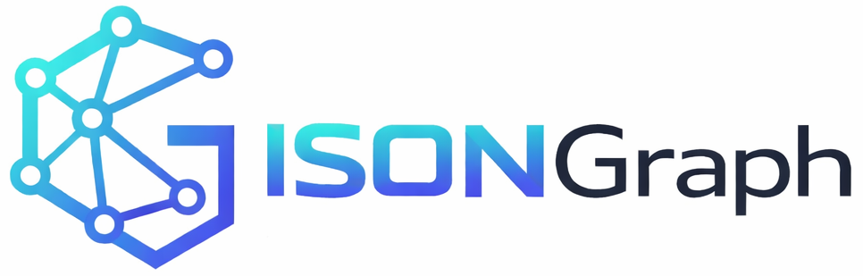

# isongraph-vector-cpp



[](https://github.com/ISON-format/isongraph-vector/releases/latest) [](https://github.com/ISON-format/isongraph-vector/blob/main/isongraph-vector-cpp/LICENSE)

[ISONGraph](https://github.com/ISON-format/isongraph) can walk a graph. It can
tell you who Alice knows, and who they know in turn. What it cannot tell you is
which node in the graph is *about* the thing you just asked for.

`isongraph-vector-cpp` closes that gap. It embeds nodes as vectors, finds the
ones closest in meaning to a query, and then traverses the graph from there —
so a question like *"who works on machine learning?"* starts at the nodes that
actually mean that, rather than at a node you had to know the id of.

This is the C++ port. See the
[repository README](https://github.com/ISON-format/isongraph-vector#readme)
for the cross-port picture.

## Installation

Header-only, C++17. The core needs nothing but the headers:

```cmake
add_subdirectory(isongraph-vector-cpp)
target_link_libraries(your_target PRIVATE isongraph_vector)
```

There is no package registry for C++, so a release is a tag and a tarball.
Pin the tag with FetchContent and CMake builds only this directory:

```cmake
include(FetchContent)
FetchContent_Declare(isongraph_vector
    GIT_REPOSITORY https://github.com/ISON-format/isongraph-vector.git
    GIT_TAG        v1.0.0
    SOURCE_SUBDIR  isongraph-vector-cpp)
FetchContent_MakeAvailable(isongraph_vector)
target_link_libraries(your_target PRIVATE isongraph_vector)
```

Or take `isongraph-vector-cpp-<version>.tar.gz` from the
[GitHub release](https://github.com/ISON-format/isongraph-vector/releases): the same directory, checksummed in
`SHA256SUMS` alongside it, for anyone who would rather pin a download than a
git ref.

`ison_graph.hpp` (ISONGraph 1.4.0, though the header constant itself still
reads 1.1.0) and `ison_parser.hpp` (ison-cpp 1.2.0) are vendored under
`vendor/ison-graph-cpp/`. There is no package registry for C++, so unlike the
other ports these are copies rather than a dependency declaration.
[`VENDORED.md`](https://github.com/ISON-format/isongraph-vector/blob/main/isongraph-vector-cpp/vendor/ison-graph-cpp/VENDORED.md) records where they came
from, and a test asserts their versions so a stale copy fails the suite instead
of passing quietly.

## The idea, in one example

```cpp
#include "isongraph_vector.hpp"

using namespace isongraph_vector;

SemanticGraph graph("social", std::make_shared<MockEncoder>(384));

graph.addNode("person", "1", {{"name", "Alice"}, {"description", "software engineer"}});
graph.addNode("person", "2", {{"name", "Bob"}, {"description", "data scientist"}});
graph.addNode("person", "3", {{"name", "Carol"}, {"description", "product manager"}});
graph.addEdge("KNOWS", NodeRef("person", "1"), NodeRef("person", "2"));
graph.addEdge("KNOWS", NodeRef("person", "2"), NodeRef("person", "3"));

MultiHopOptions options;
options.relType = "KNOWS";
options.maxHops = 2;
options.threshold = -1.0f;

for (const auto& r : graph.semanticMultiHop("Alice software engineer", options)) {
    printf("%s:%s  score=%.4f  hops=%zu\n",
           r.node_ref.type.c_str(), r.node_ref.id.c_str(), r.score, r.hop_count);
}
```

```text
person:1  score=1.0000  hops=0
person:2  score=0.8000  hops=1
person:3  score=0.6400  hops=2
```

Alice matches the query directly, so she seeds the search at hop 0. Bob and
Carol are reached by traversal, and their relevance decays by `decay ^ hops` —
0.8 and 0.64 with the default decay of 0.8. That decay is the whole point: a
node three hops from anything relevant should not outrank a direct match.

That example sets `threshold = -1.0f`, which deserves an explanation.
`MockEncoder` is deterministic and dependency-free, but its vectors carry no
meaning — they are hash-derived noise for testing plumbing. Because they are
near-orthogonal and cosine similarity is signed, mock scores straddle zero, and
the default threshold of 0.3 would reject every seed. Subclass
`EmbeddingEncoder` over a real model and the default is sensible again.

`SemanticGraph` wraps `ISONGraph` by composition. `graph()` is a **read-only**
view (`const ISONGraph&`) for counts, lookups, neighbours, paths and
serialization; everything that changes the graph goes through `SemanticGraph`
itself — `addNode`, `updateNode`, `removeNode`, `addEdge`, `removeEdge` — so a
node can never be changed without its embedding following.
Property values are `ison::Value`, typed since ISONGraph 1.4.0, but a string
literal converts implicitly, so the brace-initialised map above reads the same
as it always did.

## Beyond a single search

**Blending in a node's own relevance.** By default a node's score comes purely
from its seed and its distance. Sometimes a node two hops out is itself highly
relevant and deserves to outrank a closer but unrelated neighbour. `blend`
mixes the two:

```cpp
MultiHopOptions options;
options.blend = 0.5f;
// score = 0.5 * (seedScore * decay^hops) + 0.5 * ownSimilarity
```

At `blend = 0` (the default) scoring is pure seed-and-decay. Seeds score the
same either way, so raising it only ever reorders the nodes you reached.

**Pulling out the slice that matters.** `semanticSubgraph` runs the same search
and hands back a real `SemanticGraph` — the matching nodes, every edge induced
between them, and their embeddings. This is what makes an ISON graph useful as
LLM context: rather than serializing a whole knowledge graph into a prompt, you
serialize the part the question is actually about.

**More like this.** `similarToNode(NodeRef("person", "1"))` searches with a
node's own stored vector — no query text, no encoder call — and drops the node
itself from the results.

**Reaching a target.** `semanticPath` tries every seed that reaches the target
and returns the highest-scoring path, so a slightly less similar seed one hop
away beats a better seed five hops away (ties go to the more similar seed). The
score is `max(seed, 0) * decay^hops`: a negative seed passes no relevance along,
exactly as in `semanticMultiHop`. `embedAllNodes` backfills an existing graph in
one batched encoder call.

**Updating a node.** `SemanticGraph::updateNode` is the only way to change a
node's properties (there is no mutable `graph()` to go around it). With
auto-embed on, a change to any embed field re-embeds the node from its new
properties (and drops the vector if no text is left); an update that touches no
embed field, or a graph with auto-embed off, leaves the embedding alone. To
manage vectors by hand, construct the graph with auto-embed off and use
`embeddingStore()`. `addNode`, `addNodeWithEmbed` and `updateNode` are
all-or-nothing: if the encoder fails (a remote endpoint that is down, say), the
node is taken back out of the graph — or its old properties restored — and the
error propagates. They return `const Node&`.

**Filtering.** `nodeFilter` (a `std::function<bool(const Node&)>`) and
`nodeTypes` restrict which nodes a search may return; they combine by AND.
They work on `similaritySearch` (through a trailing `NodeFilterOptions`),
`semanticMultiHop`, `semanticSubgraph` (both through `MultiHopOptions`) and
`semanticPath` (trailing `NodeFilterOptions`):

```cpp
MultiHopOptions options;
options.nodeTypes = std::vector<std::string>{"person"};     // empty vector passes nothing
options.nodeFilter = [](const Node& n) { return n.properties.count("active") > 0; };
options.strictFilter = true;                                 // default false
```

Seeds are chosen *among* passing nodes (a filtered-out best match never takes a
seed slot) and only passing nodes are returned. By default a failing node can
still be walked *through* — it costs a hop and its decay and may appear in a
returned `path`; `strictFilter` makes the filter a hard wall for traversal too.
`semanticPath` returns `nullopt` when the target fails. An embedding whose node
is not in the graph fails whenever `nodeFilter` is set.

**Edge weights.** `options.weightField = "w"` multiplies the decay of every hop
by `clamp(edge["w"], 0, 1)`. A missing, non-numeric, boolean or NaN value counts
as 1.0; a weight of 0 scores the node 0 but still reaches it. Each node is
scored by its *best* route, which with weights can be a longer one. Unset (the
default) leaves scores exactly as they were.

**Connected subgraphs.** `options.connect = true` makes `semanticSubgraph` add
*connector* nodes so the selected nodes fall into as few connected components
as possible: greedily, the interior of the shortest route (at most
`connectMaxHops` edges, default 2, must be at least 1) between two components,
honouring `relType` and `direction`. Connectors are extra, so the result can
exceed `topKResults`; without `strictFilter` a connector may fail the filter.

**Model lifecycle.** Every vector is stamped with the writing encoder's
`modelName()` (`"mock-<dim>"` for `MockEncoder`; the base class says
`"unknown"`, and a vector stored with no encoder is `"provided"`) and the
sidecar records it, plus the encoder's `version()`. `store.models()` counts
vectors per model; `graph.staleEmbeddings()` lists nodes whose model or
dimension is not the current encoder's; `graph.reembedStale()` rewrites them
from their original text (and resets the store if the dimension changed).
`"unknown"`/`"provided"` vectors are never stale unless `includeUnknown`.
A *text* query against vectors from a different model warns once per pair
(`ModelMismatchMode::Warn`, the default), throws `ModelMismatchError`
(`Error`) or says nothing (`Ignore`); pass the mode to the `SemanticGraph` or
`EmbeddingStore` constructor. Warnings go to stderr unless you install a
callback with `setWarningHandler`. `EmbeddingStore::clear(resetDimension)` now
keeps the pinned dimension by default. The SQLite store has the same
lifecycle, see below.

## Saving and loading

```cpp
graph.save("knowledge.ison");                       // + knowledge.ison.embeddings.json
auto loaded = SemanticGraph::load("knowledge.ison", encoder);
```

The ISON graph format carries nodes and edges only, so `save` writes the
embeddings to a sidecar at `<path>.embeddings.json` — the same
`ison-embeddings` payload the Python port writes — and `load` restores it. A
graph and sidecar saved by either port loads in the other. Loading never
auto-embeds, so it needs no encoder and never overwrites saved vectors; pass the
encoder you saved with so text searches stay in the same vector space. Use
`save(path, "auto", false)` / `load(path, encoder, "auto", false)` to skip the
sidecar, and `EmbeddingStore::saveEmbeddings` / `loadEmbeddings` to work with
the payload file on its own.

**Keeping the pair consistent.** Both files are written atomically (temp file in
the same directory, flush, rename over the target), and the sidecar records a
`graph_digest` (`graphDigest()`, basis `nodes-edges-json-v1`) of the graph *as
it reads back from the text just written*. `load` verifies it and throws
`GraphEmbeddingMismatchError` if the sidecar came from another save or the
graph was edited since; `GraphMismatchMode::Warn` loads the vectors anyway and
`Reembed` rebuilds them with the encoder. A sidecar without a digest, or with a
digest of an unknown basis, is loaded unchecked. The digest is byte-for-byte
what the Python port computes (checked against
`tests/fixtures/graph_digest_golden.json` and by round-tripping files in both
directions). `embeddingStore().lastImportMeta()` exposes the sidecar's
`encoder_model`, `encoder_version` and digest fields; unknown fields are ignored.

## Storing the vectors

The default store is in memory, and the library stays header-only and
dependency-free that way. Turn the option on and you get a SQLite-backed
store:

```bash
cmake -S . -B build -DISONGRAPH_VECTOR_SQLITE=ON
cmake --build build
```

That fetches the SQLite and sqlite-vec amalgamations at configure time — both
pinned by SHA256 — and compiles them in, so no system SQLite is required.

```cpp
#include "isongraph_vector_sqlite.hpp"

SqliteEmbeddingStore store("embeddings.db", std::make_shared<MockEncoder>(384));
store.add(NodeRef("person", "1"), "Alice is a software engineer");
store.addBatch({                          // one encoder call, one transaction
    {NodeRef("person", "2"), "Bob analyses ML models"},
    {NodeRef("person", "3"), "Carol plans roadmaps"},
});
```

Pass `true` as the third constructor argument and top-k searches are answered
by a sqlite-vec `vec0` virtual table instead of a scan. It does not change
what you get back: `vec0` runs an exact brute-force KNN in C, not an
approximate index — measured identical ordering and scores within 2e-07 of the
scan. Measured over 20,000 vectors of 384 dimensions, top-10, median of five
runs: **14.7 ms** for the SQLite scan, **7.0 ms** through the index, and
**9.1 ms** for the in-memory store. Recall of the index against the exact scan
is **1.000** — the same answers, faster. Below a few thousand vectors the scan
wins outright, which is why the index is opt-in.

Top-k results come out of `std::partial_sort` rather than sorting all of them,
which is where a third of the query time used to go. Filtering by node type
stays exact too: the type is a `vec0` metadata column, so it narrows the
search rather than filtering its results.

**Model lifecycle, same as the in-memory store.** `SqliteEmbeddingStore` stamps
each row's `model` column with the encoder's `modelName()` (`"provided"` with no
encoder), keeps `models()`, `stale(model, dimension, includeUnknown)`,
`setVersion`/`version()`, `clear(resetDimension)` and `lastImportMeta()`, and
checks a *text* query against the stored models (`ModelMismatchMode`, the
fourth constructor argument, plus `setWarningHandler`). `exportEmbeddings`,
`toJson`, `fromJson`, `saveEmbeddings` (atomic) and `loadEmbeddings` produce and
read the same payload, sidecar metadata included — `toJson` is byte-identical to
`EmbeddingStore::toJson` — and an import keeps each entry's own model. Writes
and imports are transactional: a failure part way changes nothing, and
`clear(true)` / `importEmbeddings(payload, true)` drop and rebuild the
sqlite-vec index so the width can change. The `models()` counts are cached and
refreshed by every write made through the store; a change made through another
connection is not seen until the next write.

The schema is the one every port writes. The `model` column already existed
(default `'all-MiniLM-L6-v2'`) and is now written with the real model; a
database from an older release that lacks `model` (or `node_id_type`) gets it
added on open with the default `'unknown'`, and nothing else about the tables
changes, so Python, Rust, C#, TypeScript and JavaScript keep opening what this
writes. A row another port wrote carries whatever model name that port stored,
and `'all-MiniLM-L6-v2'` is an ordinary model name to this store.

The fetched SQLite targets are build-tree only and are not installed. A
consumer who wants the store either builds with the option on, or links their
own SQLite and includes `isongraph_vector_sqlite.hpp` directly.

## Approximate search (opt-in)

Search is an exact scan by default. For stores past a few hundred thousand
vectors, `EmbeddingStore::enableAnn()` (or the `ann` argument of `SemanticGraph`'s
constructor and `load`) answers bounded top-k searches from an in-memory
IVF-flat index instead: the vectors are clustered into `nlist` cells and only
the `nprobe` cells nearest the query are scored. It is the same index the
Python port has, with the same policy.

```cpp
AnnOptions ann;
ann.nprobe = 32;                       // nlist 0 = automatic: ~4*sqrt(N); nprobe 0 = ~5% of nlist
store.enableAnn(ann);                  // off by default; nothing else changes

auto hits  = store.similaritySearchVector(query, 10);                       // from the index
auto truth = store.similaritySearchVector(query, 10, "", 0.0f, /*exact=*/true);
RecallReport r = store.recallCheck(myQueries, 10);   // recall@10 against the exact scan
store.setAnnNprobe(64);                              // trade speed for recall, no rebuild
AnnStats stats = store.annStats();                   // nlist, pending, churn, memory, counters
```

It is **approximate**: a true neighbour in an unprobed cell is missed, and how
often depends on how your data clusters. Measure with `recallCheck` on real
queries before relying on a setting, and raise `nprobe` until the recall you
need holds (`nprobe >= nlist` is the exact scan). What stays the same:

- **Scores** are the exact cosine values (the top hits are re-scored with the
  exact scan's own formula), so a hit scores the same float either way.
- **`node_type`, `threshold` and `NodeFilterOptions`** apply to the probed
  rows. If fewer than k survive, the probe is widened 4x and retried, ending in
  the exact scan, so a rare type or a selective filter costs time, not results.
- **Never exact-by-accident:** `exact = true`, a `topK` that asks for every row,
  a zero query vector, a store under `minSize` (default 50,000) and
  `nprobe >= nlist` all use the plain scan.
- **Nothing is persisted.** The graph file, the embeddings sidecar and
  `graphDigest()` are byte-for-byte what they are without it; the index is
  rebuilt lazily from the loaded vectors on the first search.
- **Writes** are visible immediately: a new or updated row is scored exactly
  until enough have piled up to fold into their cells; a delete is skipped;
  when writes and deletes since training pass half the trained size the index
  retrains.

The index owns no vectors (`AnnStats::vectorBytes` is 0): it refers to the rows of
the store's single chunked matrix, so an indexed store is about 1.12x the raw
vectors at 1M x 384 (was 2.2x). Pending rows fold into their cells on the write
that makes 256 of them. It builds on all
hardware threads by default (`AnnOptions::threads`; the result does not depend on
the count) and is seeded, so the same data gives the same index however it was
inserted. Searches are `const` and share a lock, so any number run at once;
`similaritySearchBatch` runs a batch of queries on a bounded set of threads and
returns exactly what one query at a time would.

Measured with `bench/ann_bench.cpp` (build with `-DISONGRAPH_VECTOR_BENCH=ON`;
384-d synthetic clustered data, top-10, single-threaded queries, a 32-thread
machine that was also busy with other work, so treat the absolute times as
rough). "Flat SIMD scan" is a contiguous single-thread brute force over the same
vectors - what an exact search costs when it is written for speed; the
store's own exact scan walks a hash map and is several times slower:

| data | N | nprobe (of nlist) | recall@10 | index | flat SIMD scan |
|---|---|---|---|---|---|
| clustered | 100k | 63 (auto, of 1265) | 1.000 | 1.9 ms | 22 ms |
| clustered | 1M | 8 (of 4000) | 0.982 | 0.66 ms | 83 ms |
| clustered | 1M | 200 (auto) | 0.995 | 8.9 ms | 83 ms |
| diffuse (hard) | 1M | 128 | 0.927 | 8.2 ms | 81 ms |
| diffuse (hard) | 1M | 200 (auto) | 0.984 | 10.2 ms | 81 ms |

Building the index at 1M x 384 took 14-17 s on 32 threads (about 9 s with
`-DISONGRAPH_VECTOR_BENCH_NATIVE=ON`'s AVX2 build, 186 s on one thread). On hard,
diffuse data the speed-up shrinks to about 8x over a flat scan at good recall,
and below ~100k vectors a flat scan is already a few milliseconds, which is why
this is opt-in and `minSize` defaults to 50,000. Queries are memory-bound, so
AVX2 barely changes them; it mainly speeds the build. The in-memory store only:
`SqliteEmbeddingStore` has no approximate index (its `vec0` option is exact).

## Embedding over HTTP

`HttpEncoder` (`isongraph_vector_http.hpp`) is an `EmbeddingEncoder` that gets
its vectors from an HTTP endpoint. It POSTs `{"model": ..., "input": [texts]}`
and reads either an OpenAI-style response (`data[i].embedding`, ordered by
`index`; OpenAI and the many servers that copy it) or an Ollama `/api/embed` one
(`embeddings`); the shape is detected, not configured.

```cpp
#include "isongraph_vector_http.hpp"

HttpEncoderOptions options;
options.url = "https://api.openai.com/v1/embeddings";
options.model = "text-embedding-3-small";      // sent as `model`, reported as modelName()
options.apiKey = std::getenv("OPENAI_API_KEY");
options.dimension = 1536;                      // optional, see below

auto encoder = std::make_shared<HttpEncoder>(options);
SemanticGraph graph("kb", encoder);            // texts are embedded over HTTP
```

**Every text you embed is sent to the endpoint you configure.** With a hosted
service the contents of your nodes leave the machine; point `url` at a local
server (Ollama on `http://localhost:11434/api/embed`) if they must not. The API
key goes in the `Authorization: Bearer` header by default (`apiKeyHeader` /
`apiKeyPrefix` change that, e.g. `api-key` for Azure). It is never put in an
exception message — it is also scrubbed from the server's own error text, in
case an error page echoes it — and constructing an encoder with a key and a
plain `http://` URL to a non-local host emits a warning.

Options: `batchSize` (texts per request, default 64; `encodeBatch` splits
larger batches), `timeoutMs`, extra `headers`, `version`, and a bounded retry
(`maxRetries` 3, `retryBackoffMs` 500 doubling up to `maxBackoffMs`, honouring a
`Retry-After` in seconds) on HTTP 429, 5xx and transport failures. Other
statuses throw `HttpError` (an `EmbeddingError` carrying `status()`) with the
server's message; a malformed or mis-sized response throws `EmbeddingError`, a
vector of the wrong width `DimensionMismatchError`. `dimension()` is the
`dimension` option, or what the first response had; asked before anything has
been encoded it sends one request with the fixed text `dimension probe`. Set
`dimension` to avoid that. Texts must be UTF-8. Not safe to call from several
threads at once.

**The header has no dependencies: the transport is yours.** `HttpEncoder` takes
a `std::function<HttpResponse(const HttpRequest&)>`, so it works with whatever
HTTP library the application already links — and with a fake in tests, which is
how this port tests it (no network):

```cpp
HttpEncoder encoder(options, [](const HttpRequest& request) {
    HttpResponse response;
    response.status = ...;   // from your HTTP stack
    response.body = ...;     // request.url, .headers, .body, .timeoutMs
    return response;         // throw HttpError when no response could be obtained
});
```

A ready-made libcurl transport, `CurlTransport`, is compiled in when
`ISONGRAPH_VECTOR_CURL` is defined, and then `HttpEncoder(options)` uses it by
default. With CMake, `-DISONGRAPH_VECTOR_CURL=ON` finds libcurl and gives you an
`isongraph_vector_curl` target to link (it defines the macro). It does not
follow redirects (so the key is never forwarded), allows only http and https,
sends no `Expect: 100-continue` (a large batch would otherwise wait a second
for a server that does not answer it), and caps a response at 64 MiB. It is off
by default and nothing else needs libcurl. Its tests run against a small HTTP
server inside the test process on 127.0.0.1 (OpenAI- and Ollama-shaped answers,
error statuses, retries, a stall and timeout, a redirect that must not be
followed, an oversized body, API-key redaction); no internet is used. On
Windows, `#define NOMINMAX` before including `<windows.h>`, `<winsock2.h>` or
`<curl/curl.h>` in your own code, as `windows.h`'s `min`/`max` macros break the
library headers.

## One format, six languages

The SQLite schema and the portable JSON payload are shared by every port —
Python, C#, TypeScript, JavaScript, Rust and C++ — so a database or payload
written by one can be read by another. `MockEncoder` is byte-identical across
all six, and the `id` column is an MD5 prefix computed the same way everywhere;
the suite checks that MD5 against known vectors so a row written here matches a
row written by Python byte for byte.

## Things that will bite you

- **Search is brute force by default**, sqlite-vec included: linear in the
  number of nodes. `enableAnn()` adds an opt-in approximate index for large
  in-memory stores (see above), at the price of recall you have to measure. This
  is built for an application's own knowledge graph, not as a vector-database
  replacement.
- **One embedding per node**, from one text field or a concatenation. No
  multi-vector nodes, no edge embeddings.
- **`MockEncoder` has no semantic structure.** Use it to test plumbing, never
  to judge relevance quality. For real embeddings use `HttpEncoder` against an
  embeddings endpoint (texts leave the process, see above) or subclass
  `EmbeddingEncoder` over a model you run in-process.
- **The base library is vendored, not versioned.** There is no upgrade
  notification, so re-copy the headers when ISONGraph moves on. A test asserts
  the vendored versions against
  [`VENDORED.md`](https://github.com/ISON-format/isongraph-vector/blob/main/isongraph-vector-cpp/vendor/ison-graph-cpp/VENDORED.md), so at least a *stale*
  copy fails loudly rather than passing quietly.
- **Node ids are always strings here.** A sidecar from a port with integer ids
  loads fine (`"id":1` becomes `"1"`), but this port writes `"id_type":"str"`.
  `graphDigest(graph)` therefore tags every id as a string unless you pass a
  predicate saying which are integers; `save`/`load` digest the ISON text, which
  records which was which, so they agree with Python either way.
- **Digest edge cases.** Floats the ISON parser reads back as strings
  (exponent forms such as `1e-09`) are digested as the strings they read as,
  which is also what Python's parser produces, so such graphs still verify
  across ports. Integers beyond 64 bits are not supported.
- **Saves use LF line endings and no `fsync`.** Graph files are written with
  a bare line feed on every platform (previously the platform's text mode); the
  temp file is flushed and renamed, which protects against torn writes but not
  against power loss.
- **Auto-embed renders typed properties.** Nulls and references contribute
  nothing and booleans render as `true`/`false`, so the same graph produces the
  same text in every port.

## Tests

```bash
cmake -S . -B build && cmake --build build
./build/test_isongraph_vector                 # 188 tests, 21 of them the approximate index

cmake -S . -B build -DISONGRAPH_VECTOR_SQLITE=ON && cmake --build build
./build/test_isongraph_vector_sqlite          # + 37 SQLite tests

cmake -S . -B build -DISONGRAPH_VECTOR_CURL=ON && cmake --build build
./build/test_isongraph_vector_curl            # + 21 libcurl transport tests (loopback server, no internet)

cmake -S . -B build -DISONGRAPH_VECTOR_BENCH=ON -DCMAKE_BUILD_TYPE=Release && cmake --build build --config Release
./build/ann_bench --sizes 10000,100000,1000000   # exact vs approximate latency and recall; --json out.jsonl
```

On a multi-config generator such as Visual Studio the binaries land in
`build/Debug/`.

## Changes to the API since the last snapshot

Nothing from 1.0.0 has shipped, so these are breaking changes made in place:

- New, opt-in and additive: `EmbeddingStore::enableAnn / disableAnn / annEnabled /
  setAnnNprobe / buildAnnIndex / annStats / recallCheck / recallCheckTexts`,
  the `AnnOptions`, `AnnStats` and `RecallReport` types, an `exact` flag on
  `similaritySearch` / `similaritySearchVector`, and on `SemanticGraph` an
  `ann` constructor / `load` argument, `similaritySearchVector`, an `exact` flag
  and `recallCheck`. Existing calls behave exactly as before.

- `SemanticGraph::graph()` is `const ISONGraph&` only. Replace
  `graph.graph().addEdge(...)` / `removeEdge(...)` with `graph.addEdge(...)` /
  `graph.removeEdge(...)`; `graph().addNode/updateNode/removeNode` are gone
  (use the `SemanticGraph` methods — for a node without a vector, construct the
  graph with auto-embed off).
- `SemanticGraph::addNode`, `addNodeWithEmbed` and `updateNode` return
  `const Node&` instead of `Node&`, and now undo themselves if embedding fails.
- `SqliteEmbeddingStore::clear()` keeps the pinned dimension by default (it
  always reset it); pass `true` to reset. `importEmbeddings(payload, true)`
  adopts the payload's dimension, as the in-memory store does.
- `SqliteEmbeddingStore` stamps the encoder's `modelName()` in the `model`
  column instead of `'unknown'`, and an import keeps each entry's own model.

## Links

- Repository: <https://github.com/ISON-format/isongraph-vector>
- Documentation: <https://graph.ison.dev/docs/isongraph-vector>

## License

MIT — see [LICENSE](https://github.com/ISON-format/isongraph-vector/blob/main/isongraph-vector-cpp/LICENSE). Copyright (c) 2026 ISON - Mahesh Vaikri.
