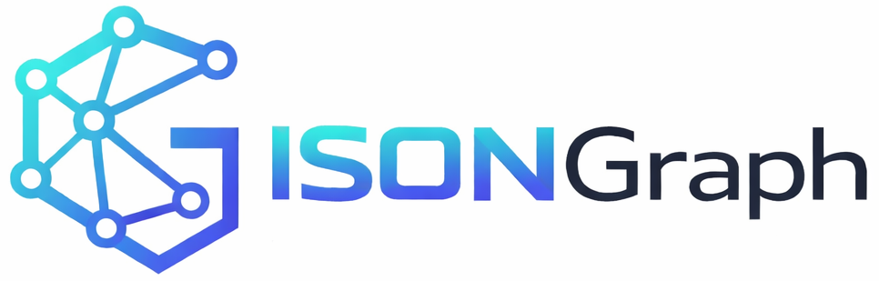

# IsonGraph.Vector



[](https://www.nuget.org/packages/IsonGraph.Vector/) [](https://www.nuget.org/packages/IsonGraph.Vector.Sqlite/) [](https://github.com/ISON-format/isongraph-vector/blob/main/isongraph-vector-csharp/LICENSE)

[ISONGraph](https://github.com/ISON-format/isongraph) can walk a graph. It can
tell you who Alice knows, and who they know in turn. What it cannot tell you is
which node in the graph is *about* the thing you just asked for.

`IsonGraph.Vector` closes that gap. It embeds nodes as vectors, finds the ones
closest in meaning to a query, and then traverses the graph from there — so a
question like *"who works on machine learning?"* starts at the nodes that
actually mean that, rather than at a node you had to know the id of.

This is the .NET port. See the
[repository README](https://github.com/ISON-format/isongraph-vector#readme)
for the cross-port picture.

## Installation

```bash
dotnet add package IsonGraph.Vector          # core
dotnet add package IsonGraph.Vector.Sqlite   # + SQLite storage and sqlite-vec
```

Targets `net8.0` and builds on
[`IsonGraph`](https://www.nuget.org/packages/IsonGraph) 1.4.0.

## The idea, in one example

```csharp
using IsonGraph;
using IsonGraph.Vector;

var graph = new SemanticGraph("social", new MockEncoder(384));

graph.AddNode("person", "1", new() { ["name"] = "Alice", ["description"] = "software engineer" });
graph.AddNode("person", "2", new() { ["name"] = "Bob", ["description"] = "data scientist" });
graph.AddNode("person", "3", new() { ["name"] = "Carol", ["description"] = "product manager" });
graph.AddEdge("KNOWS", new NodeRef("person", "1"), new NodeRef("person", "2"));
graph.AddEdge("KNOWS", new NodeRef("person", "2"), new NodeRef("person", "3"));

var results = graph.SemanticMultiHop("Alice software engineer", new MultiHopOptions
{
    RelType = "KNOWS",
    MaxHops = 2,
    Threshold = -1.0f,
});

foreach (var r in results)
    Console.WriteLine($"{r.NodeRef.Type}:{r.NodeRef.Id}  score={r.Score:F4}  hops={r.HopCount}");
```

```text
person:1  score=1.0000  hops=0
person:2  score=0.8000  hops=1
person:3  score=0.6400  hops=2
```

Alice matches the query directly, so she seeds the search at hop 0. Bob and
Carol are reached by traversal, and their relevance decays by `Decay ** hops` —
0.8 and 0.64 with the default decay of 0.8. That decay is the whole point: a
node three hops from anything relevant should not outrank a direct match.

That example passes `Threshold = -1.0f`, which deserves an explanation.
`MockEncoder` is deterministic and dependency-free, but its vectors carry no
meaning — they are hash-derived noise for testing plumbing. Because they are
near-orthogonal and cosine similarity is signed, mock scores straddle zero, and
the default threshold of 0.3 would reject every seed. Supply your own
`IEmbeddingEncoder` over a real model - for instance `HttpEmbeddingEncoder`
below - and the default is sensible again.

`ISONGraph` is `sealed`, so `SemanticGraph` wraps it by composition rather than
inheriting from it. The wrapped graph is private: `.Graph` is a read-only view
(`IReadOnlyGraph`) for lookups, counts, neighbors, traversals, paths and ISON
serialization, and every mutation - `AddNode`, `UpdateNode`, `RemoveNode`,
`AddEdge`, `RemoveEdge` - goes through the `SemanticGraph` itself, which is why
the edges above are added there.

## Beyond a single search

**Blending in a node's own relevance.** By default a node's score comes purely
from its seed and its distance. Sometimes a node two hops out is itself highly
relevant and deserves to outrank a closer but unrelated neighbour. `Blend`
mixes the two:

```csharp
var results = graph.SemanticMultiHop(query, new MultiHopOptions { Blend = 0.5f });
// score = 0.5 * (seedScore * decay^hops) + 0.5 * ownSimilarity
```

At `Blend = 0` (the default) scoring is pure seed-and-decay. Seeds score the
same either way, so raising it only ever reorders the nodes you reached.

**Pulling out the slice that matters.** `SemanticSubgraph` runs the same search
and hands back a real `SemanticGraph` — the matching nodes, every edge induced
between them, and their embeddings. This is what makes an ISON graph useful as
LLM context: rather than serializing a whole knowledge graph into a prompt, you
serialize the part the question is actually about.

**More like this.** `SimilarToNode(new NodeRef("person", "1"))` searches with a
node's own stored vector — no query text, no encoder call — and drops the node
itself from the results.

Alongside those: `SemanticPath` to reach a specific target from a
semantically-relevant start, `EmbedAllNodes` to backfill an existing graph in
one batched encoder call, and `EmbedNodes` for batching your own pairs.

`SemanticPath` scores every seed that reaches the target as
`max(seedScore, 0) * decay^hops` and returns the best, so a slightly less
similar seed one hop away beats a better seed five hops away (a tie goes to the
more similar seed). A negative seed score is clamped to 0, as in
`SemanticMultiHop`.

## Filtering, weighting and connecting

**Filter by node.** `SimilaritySearch`, `SemanticMultiHop`, `SemanticPath` and
`SemanticSubgraph` take a `nodeFilter` (`Func<Node, bool>`) and `nodeTypes`
(on `MultiHopOptions` for the traversals). They combine by AND with each other
and with `nodeType`. Seeds must pass and are chosen *among* passing nodes, so a
filtered-out best match never takes a seed slot, and only passing nodes are
returned. By default a node that fails can still be walked *through* (it costs a
hop and its decay, and a returned path may list it); `StrictFilter = true` (or
`strictFilter: true` on `SemanticPath`) makes the filter a hard wall. A
`SemanticPath` whose target fails returns `null`. A reference with no node in
the graph fails whenever a `nodeFilter` is set.

```csharp
var people = graph.SemanticMultiHop("who builds search?", new MultiHopOptions
{
    NodeTypes = new[] { "person" },
    NodeFilter = n => n.Properties.TryGetValue("active", out var a) && a is true,
});
```

**Weight the edges.** `WeightField = "w"` multiplies each hop's decay by
`clamp(edge["w"], 0, 1)`. A missing, non-numeric, boolean or NaN weight counts as
1.0; a weight of 0 scores 0 but stays reachable; a node is scored by its best
route, which may be longer than the shortest. With `WeightField = null` (the
default) scores are bit-identical to before.

**Keep the slice connected.** `SemanticSubgraph(query, options, connect: true,
connectMaxHops: 2)` adds connector nodes so the selected nodes fall into as few
weakly connected components as possible: greedily, it adds the interior of the
shortest route (at most `connectMaxHops` edges, honouring `RelType`/`Direction`)
between two components until one remains or nothing fits. The result can hold
more than `TopKResults` nodes, connectors are not marked, and without
`StrictFilter` a connector may fail the filter. `connectMaxHops` below 1 throws.

## A real model over HTTP

`HttpEmbeddingEncoder` implements `IEmbeddingEncoder` against any HTTP
embeddings endpoint, using only `System.Net.Http` and `System.Text.Json` (no new
package). It POSTs `{"model": ..., "input": [texts]}` and reads either the
OpenAI shape (`data[i].embedding`, ordered by `index`) or Ollama's `/api/embed`
shape (`embeddings`), which covers OpenAI, Azure OpenAI, Ollama, vLLM, LiteLLM,
LM Studio, text-embeddings-inference and the like.

```csharp
using var encoder = new HttpEmbeddingEncoder(new HttpEmbeddingOptions
{
    Url = "https://api.openai.com/v1/embeddings",
    Model = "text-embedding-3-small",
    Dimension = 1536,                       // optional; learned from the first reply if omitted
    ApiKey = Environment.GetEnvironmentVariable("OPENAI_API_KEY"),
});
var graph = new SemanticGraph("kb", encoder);

// Ollama, no key:
//   Url = "http://localhost:11434/api/embed", Model = "nomic-embed-text"
```

**Every text you embed is sent to that URL** - node text on `AddNode`,
`EmbedAllNodes` and `ReembedStale`, and each search query. Use an endpoint you
trust with that text. The encoder's `ModelName` is `Model`, so switching models
makes the stored vectors stale and `ReembedStale` / `Load` handle it as usual.

Options: `ApiKey` (sent as `Authorization: Bearer`, or raw in `ApiKeyHeader`,
e.g. `api-key` for Azure), `Headers`, `ExtraBody` (e.g. `dimensions`),
`BatchSize` (default 64; larger inputs are split into sequential requests),
`Timeout` (per attempt, default 60 s), `MaxRetries` (default 2) with
`RetryDelay` backoff on 429, 5xx, timeouts and network errors (a `Retry-After`
header is honoured, capped by `MaxRetryDelay`), and `Version`. Pass an
`HttpClient` or an `HttpMessageHandler` to the constructor to supply your own
(proxy, test double). Failures throw `HttpEmbeddingException` (with
`StatusCode`); its message names the URL without the query string and never
contains the API key or header values. An API key is refused over plain `http://`
to a non-loopback host unless `AllowInsecureHttp` is set.

`IEmbeddingEncoder` is synchronous, so `Encode`/`EncodeBatch` block on the
request (without capturing a synchronization context); where you can await, use
`EncodeAsync` / `EncodeBatchAsync(texts, cancellationToken)`. Reading
`Dimension` when it was not configured and nothing has been encoded yet makes
one probe request with the text `dimension probe`, so set `Dimension` if you
want construction to stay offline.

## Models and consistency

Every stored vector records the model that made it (`IEmbeddingEncoder.ModelName`,
`"mock-<dim>"` for `MockEncoder`; encoders that do not say record `"unknown"`,
and vectors handed in with no encoder record `"provided"`). Encoders and stores
also carry a free-form `Version`.

```csharp
graph.EmbeddingStore.Models();          // { "mock-384": 120 }
graph.SetEncoder(newEncoder);
graph.StaleEmbeddings();                // nodes whose vector is another model's or width
graph.ReembedStale(batchSize: 256);     // re-encode them, keeping custom embed text
```

`"unknown"`/`"provided"` vectors are never stale unless you pass
`includeUnknown: true` (a dimension mismatch always counts). A text query whose
encoder differs from the stored vectors' model raises the store's `Warning`
event once per pair of models (standard error if nobody listens); construct with
`onModelMismatch: ModelMismatchMode.Error` for a `ModelMismatchException`, or
`Ignore`. Vector queries are never checked. `Clear(resetDimension)` forgets the
pinned width (it defaults to true, as `Clear()` always did).

`Save` writes the graph file, then the sidecar, each atomically (temp file,
flush, move), and records a `GraphDigest` of the graph as it re-reads from the
file just written, plus `encoder_model` and `encoder_version`, after the
`embeddings` array so version-1 readers ignore them. `Load` verifies the digest:

```csharp
SemanticGraph.Load(path, encoder);                                          // mismatch throws GraphEmbeddingMismatchException
SemanticGraph.Load(path, encoder, onMismatch: GraphMismatchMode.Warn);      // use the vectors anyway
SemanticGraph.Load(path, encoder, onMismatch: GraphMismatchMode.Reembed);   // rebuild them from the graph
```

A sidecar with no digest, or a digest of a basis this build does not know
(`nodes-edges-json-v1` is the one it writes), is loaded as before. The digest is
byte-identical to the Python port's, so a pair saved by one port verifies in the
other; `GraphDigest.Compute(graph)` and `GraphDigest.OfText(isonText)` expose it.
`store.LastImportMeta` holds the metadata of the last imported sidecar.

## Keeping embeddings in step

Change a node through `SemanticGraph.UpdateNode`:

```csharp
graph.UpdateNode("person", "1", new() { ["name"] = "Alicia" });
```

With auto-embed on, touching any embed field re-embeds the node from its new
properties; if nothing is left to embed the stale vector is dropped. Updates to
other fields, and graphs created with `autoEmbed: false`, leave the embedding
alone.

There is no way around it: `graph.Graph` is a read-only view
(`IReadOnlyGraph`) with no `AddNode`, `UpdateNode`, `RemoveNode`, `AddEdge`
or `RemoveEdge`, so a node cannot be changed behind the embedding store's back.
The nodes, edges and paths it (and `AddNode`/`UpdateNode`/`AddEdge`) return are
detached copies, because `ISONGraph` hands out live objects whose `Properties`
dictionary is mutable; editing a returned `Node.Properties` changes nothing.
The same goes for the `Node` handed to your `nodeFilter`, `EmbedAllNodes` text
function and `Traverse` filter. The view is live - it reflects later changes
made through the `SemanticGraph`. Edges carry no embedding, so `AddEdge` and
`RemoveEdge` are plain pass-throughs; they live on `SemanticGraph` so that every
mutation has one entry point.

## Saving and loading a graph

The ISON file format carries nodes and edges only, so `Save` writes the
embeddings to a sidecar next to it, and `Load` restores them:

```csharp
graph.Save("social.ison");                 // also writes social.ison.embeddings.json
var loaded = SemanticGraph.Load("social.ison", new MockEncoder(384));

graph.Save("social.ison", embeddings: false);   // graph file only
SemanticGraph.EmbeddingsPathFor("social.ison"); // "social.ison.embeddings.json"
```

The sidecar is the same `ison-embeddings` payload as `ToJson`, so a graph saved
by the Python port loads here and vice versa. `Load` does not re-embed from node
properties (the saved vectors and texts are kept exactly), and you pass the
encoder the graph was saved with so later text queries land in the same vector
space. As in the other ports, the graph name comes back from the file name and
the graph comes back directed (an undirected graph's mirrored edges are kept).

## Storing the vectors

The core package keeps embeddings in memory. Add `IsonGraph.Vector.Sqlite` and
they persist:

```csharp
using IsonGraph.Vector.Sqlite;

using var store = new SqliteEmbeddingStore("embeddings.db", new MockEncoder(384));
store.Add(new NodeRef("person", "1"), "Alice is a software engineer");
store.AddBatch(new[] {                    // one encoder call, one transaction
    (new NodeRef("person", "2"), "Bob analyses ML models"),
    (new NodeRef("person", "3"), "Carol plans roadmaps"),
});
```

Pass `sqliteVec: true` and top-k searches are answered by a sqlite-vec `vec0`
virtual table instead of a scan:

```csharp
using var store = new SqliteEmbeddingStore("embeddings.db", encoder, sqliteVec: true);
```

It does not change what you get back. `vec0` runs an exact brute-force KNN in
C, not an approximate index — measured identical ordering and scores within
2e-07 of the scan. Measured over 20,000 vectors of 384 dimensions, top-10,
median of five runs: **37 ms** for the SQLite scan, **7.1 ms** through the
index, and **5.9 ms** for the in-memory store. Recall of the index against the
exact scan is **1.000** — the same answers, faster. Below a few thousand
vectors the scan wins outright, which is why the index is opt-in.

Note which pair that speedup is between: the index replaces the SQLite scan,
not the in-memory store. `IsonGraph.Vector`'s own store is faster still at
this size, because it never leaves managed memory. Reach for the index when
the vectors have to be on disk anyway.

Top-k results come out of a bounded insertion rather than sorting all of them,
which is where a third of the query time used to go. Filtering by node type
stays exact too: the type is a `vec0` metadata column, so it narrows the
search rather than filtering its results.

`Dispose` closes the connection and clears the ADO.NET pool, so the database
file is genuinely released and can be moved or deleted.

## One format, six languages

The SQLite schema and the portable JSON payload are shared by every port —
Python, C#, TypeScript, JavaScript, Rust and C++ — so a database or payload
written by one can be read by another. `MockEncoder` is byte-identical across
all six, which is what makes that guarantee testable rather than aspirational;
this suite proves it by importing a payload captured from the Python port and
checking the vectors match what C# encodes for the same text.

```csharp
var payload = store.ExportEmbeddings();
var json = store.ToJson();
store.FromJson(json);
```

## Things that will bite you

- **Search is brute force**, sqlite-vec included: linear in the number of
  nodes. This is built for an application's own knowledge graph, not as a
  vector-database replacement.
- **One embedding per node**, from one text field or a concatenation. No
  multi-vector nodes, no edge embeddings.
- **`MockEncoder` has no semantic structure.** Use it to test plumbing, never
  to judge relevance quality. For real vectors use `HttpEmbeddingEncoder`
  (which sends your text to the endpoint you configure) or implement
  `IEmbeddingEncoder` over a model of your own.
- **Auto-embed renders typed properties.** Since ISONGraph 1.4.0 a property can
  be a number, a bool or null. Nulls are skipped and booleans render as ISON
  spells them (`true`/`false`, not .NET's `True`), so the same graph produces
  the same text in every port. Floats use the invariant culture — `1.5` never
  `1,5`.
- **Digests and ids.** C# node ids are strings. `Save`/`Load` take the digest
  from the file's text, where an integer id is unquoted, so a pair written by
  the Python port verifies here. `GraphDigest.Compute(graph.Graph)` of an in-memory
  graph cannot know which ids "meant" integers: it treats plain decimal text
  (`-?[0-9]+`) as one, or takes a predicate. Integers beyond 64 bits read as
  strings here but as integers in Python, so a graph holding one verifies with a
  false mismatch (use `GraphMismatchMode.Warn`). The IsonGraph 1.4.0 package
  this depends on cannot read the `meta.graph` block Python writes for an
  undirected graph, so such a file does not load here.
- **Warnings are events, not exceptions.** There is no `warnings` module in
  .NET: subscribe to `Warning` (or pass `onWarning` to `Load`), or they go to
  standard error.
- **The vec0 natives come from a redistribution.** asg017's own `sqlite-vec`
  package has never left prerelease on NuGet, and a stable package cannot
  depend on a prerelease one, so this port takes its natives from
  `HiraokaHyperTools.sqlite-vec` 0.1.9 - the same upstream C, at the same
  version the Rust, Node and C++ ports use. The core `IsonGraph.Vector`
  package has no such dependency.

## Tests

```bash
dotnet test        # 222 tests
```

## Links

- Repository: <https://github.com/ISON-format/isongraph-vector>
- Documentation: <https://graph.ison.dev/docs/isongraph-vector>

## License

MIT — see [LICENSE](https://github.com/ISON-format/isongraph-vector/blob/main/isongraph-vector-csharp/LICENSE). Copyright (c) 2026 ISON - Mahesh Vaikri.
