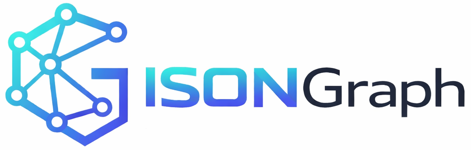

# isongraph-vector-js



[](https://www.npmjs.com/package/isongraph-vector-js) [](https://github.com/ISON-format/isongraph-vector/blob/main/isongraph-vector-js/LICENSE)

[ISONGraph](https://github.com/ISON-format/isongraph) can walk a graph. It can
tell you who Alice knows, and who they know in turn. What it cannot tell you is
which node in the graph is *about* the thing you just asked for.

`isongraph-vector-js` closes that gap. It embeds nodes as vectors, finds the
ones closest in meaning to a query, and then traverses the graph from there —
so a question like *"who works on machine learning?"* starts at the nodes that
actually mean that, rather than at a node you had to know the id of.

This is the JavaScript port. See the
[repository README](https://github.com/ISON-format/isongraph-vector#readme)
for the cross-port picture.

## Installation

```bash
npm install isongraph-vector-js
npm install sqlite-vec          # optional, for the indexed SQLite store
```

Built on [`ison-graph-js`](https://www.npmjs.com/package/ison-graph-js) 1.4.0.
The main entry point has no Node-specific imports, so it runs in a browser as
well as in Node.

## The idea, in one example

```javascript
import { SemanticGraph, MockEncoder } from 'isongraph-vector-js';

const graph = new SemanticGraph({ name: 'social', encoder: new MockEncoder(384) });

graph.addNode('person', 1, { name: 'Alice', description: 'software engineer' });
graph.addNode('person', 2, { name: 'Bob', description: 'data scientist' });
graph.addNode('person', 3, { name: 'Carol', description: 'product manager' });
graph.addEdge('KNOWS', ['person', 1], ['person', 2]);
graph.addEdge('KNOWS', ['person', 2], ['person', 3]);

const results = graph.semanticMultiHop('Alice software engineer', {
  relType: 'KNOWS',
  maxHops: 2,
  threshold: -1.0,
});

for (const r of results) {
  console.log(`${r.nodeRef.join(':')}  score=${r.score.toFixed(4)}  hops=${r.hopCount}`);
}
```

```text
person:1  score=1.0000  hops=0
person:2  score=0.8000  hops=1
person:3  score=0.6400  hops=2
```

Alice matches the query directly, so she seeds the search at hop 0. Bob and
Carol are reached by traversal, and their relevance decays by `decay ** hops` —
0.8 and 0.64 with the default decay of 0.8. That decay is the whole point: a
node three hops from anything relevant should not outrank a direct match.

That example passes `threshold: -1.0`, which deserves an explanation.
`MockEncoder` is deterministic and dependency-free, but its vectors carry no
meaning — they are hash-derived noise for testing plumbing. Because they are
near-orthogonal and cosine similarity is signed, mock scores straddle zero, and
the default threshold of 0.3 would reject every seed. Supply your own
`EmbeddingEncoder` over a real model and the default is sensible again.

`addNode` auto-embeds from the node's properties, using the `embedFields` list
(`name`, `description`, `content`, `text` by default). Pass an explicit text
with `addNodeWithEmbed` when you want to control the wording.

## Beyond a single search

**Blending in a node's own relevance.** By default a node's score comes purely
from its seed and its distance. Sometimes a node two hops out is itself highly
relevant and deserves to outrank a closer but unrelated neighbour. `blend`
mixes the two:

```javascript
const results = graph.semanticMultiHop(query, { blend: 0.5 });
// score = 0.5 * (seedScore * decay^hops) + 0.5 * ownSimilarity
```

At `blend: 0` (the default) scoring is pure seed-and-decay. Seeds score the
same either way, so raising it only ever reorders the nodes you reached.

**Pulling out the slice that matters.** `semanticSubgraph` runs the same search
and hands back a real `SemanticGraph` — the matching nodes, every edge induced
between them, and their embeddings. This is what makes an ISON graph useful as
LLM context: rather than serializing a whole knowledge graph into a prompt, you
serialize the part the question is actually about.

**More like this.** `similarToNode(['person', 1])` searches with a node's own
stored vector — no query text, no encoder call — and drops the node itself from
the results.

Alongside those: `semanticPath` to reach a specific target from a
semantically-relevant start, and `embedAllNodes` to backfill an existing graph
in one batched encoder call. `semanticPath` evaluates every seed that reaches
the target and returns the highest-scoring path (`max(seed, 0) * decay^hops`),
so a slightly less similar seed one hop away beats a better seed five hops away.

**Updates keep the vector honest.** With `autoEmbed` on, `updateNode` re-embeds
a node when one of the `embedFields` changes, and drops its vector if nothing
is left to embed. Updates that touch no embed field, and graphs with
`autoEmbed: false`, leave the embedding alone.

Both the options-object and the original positional form of `semanticMultiHop`
are accepted, so older call sites keep working. `semanticPath` takes an options
object in place of `relType` too (and has `direction`).

**Filtering by node.** `nodeFilter` (a predicate on the node), `nodeTypes` (a
type, or an array; an empty array passes nothing) and `strictFilter` work on
`similaritySearch`, `semanticMultiHop`, `semanticPath` and `semanticSubgraph`
(`similaritySearch` has no `strictFilter`; it does not traverse):

```javascript
graph.similaritySearch(query, 5, undefined, 0.0, n => n.properties.active, ['person']);
graph.semanticMultiHop(query, { nodeTypes: ['person'], strictFilter: true });
```

Both filters combine with AND. The top `topKSeeds` are chosen *among* passing
nodes, so a filtered-out best match never takes a seed slot, and only passing
nodes are returned. By default a failing node can still be walked *through*
(it costs a hop and its decay, and may appear in a returned `path`);
`strictFilter` never enters one. `semanticPath` returns `null` when the target
fails. A ref with no node in the graph fails whenever `nodeFilter` is set.

**Weighting edges.** `weightField: 'confidence'` multiplies each hop's decay by
that numeric edge property, clamped to [0, 1]; a missing, non-numeric, boolean
or NaN value counts as 1. A weight of 0 gives a score of 0 but the node stays
reachable. A node is scored by its best route, which may be longer than the
fewest-hops route. Without `weightField`, scores are unchanged to the bit.

**Keeping the slice connected.** `semanticSubgraph(query, { connect: true })`
adds connector nodes (greedily, shortest route first, at most `connectMaxHops`
edges per join, default 2) so the selected nodes fall into as few components as
possible. The result can hold more than `topKResults` nodes; connectors may
fail the node filter unless `strictFilter` is set.

**Model changes.** Each vector records the model that made it (the encoder's
`modelName`; `MockEncoder` is `mock-<dim>`), and an encoder may carry a
`version`. `store.models()` counts vectors per model;
`graph.staleEmbeddings(includeUnknown?)` lists nodes whose vector is from
another model or dimension, and `graph.reembedStale(includeUnknown?,
batchSize?)` rebuilds them from their original text. Vectors recorded as
`unknown`/`provided` are never stale unless you pass `includeUnknown`.
A *text* query against vectors from a different model warns once per pair
(`onModelMismatch: 'warn'`, the default), throws `ModelMismatchError`
(`'error'`) or stays quiet (`'ignore'`); vector queries are never checked.
`store.clear(true)` also forgets the pinned dimension.

`SqliteEmbeddingStore` has the same model lifecycle as the in-memory store:
`models()`, `stale(model?, dimension?, includeUnknown?)` (or an options
object), `clear(resetDimension?)`, `onModelMismatch` and `version` (as
constructor options `new SqliteEmbeddingStore(path, encoder, sqliteVec,
{ version, onModelMismatch })` or properties), `exportEmbeddings(graphDigest?)`
with the same `encoder_model` / `encoder_version` / `graph_digest` fields,
`lastImportMeta`, and the per-vector `model` on export and import. The model is
kept in the `model` column the shared SQLite schema already has; a database
whose table lacks it gets `ALTER TABLE ... ADD COLUMN model TEXT DEFAULT
'unknown'`, and databases written by the other ports open unchanged. There is
no `reembedStale` on the bare store - re-`add` the refs `stale()` returns.
`saveEmbeddings` / `loadEmbeddings` from the `/node` entry accept this store
too. Unlike before, `clear()` no longer forgets the pinned dimension unless you
pass `true`.

## Storing the vectors

The default store is in memory. For persistence, import the SQLite store from
the `/sqlite` entry point:

```javascript
import { SqliteEmbeddingStore } from 'isongraph-vector-js/sqlite';
import { MockEncoder } from 'isongraph-vector-js';

const store = new SqliteEmbeddingStore('embeddings.db', new MockEncoder(384));
store.add(['person', '1'], 'Alice is a software engineer');
store.addBatch([                          // one encoder call, one transaction
  [['person', '2'], 'Bob analyses ML models'],
  [['person', '3'], 'Carol plans roadmaps'],
]);
store.close();
```

It is a separate entry point on purpose: it imports `node:sqlite`, so pulling
it into the main module would break browser bundles. Node's built-in SQLite
means no native module to install - but it does set a floor: **the `/sqlite`
entry point needs Node 24**, while the main entry point runs on Node 18 and up,
and in a browser. CI enforces exactly that split, running the full suite on
Node 24 and the main-entry tests on 20 and 22.

`npm run test:core` runs the main-entry tests alone, which is what to use if
your Node is too old for `node:sqlite`.

Pass `true` as the third argument and top-k searches are answered by a
sqlite-vec `vec0` virtual table instead of a scan:

```javascript
const store = new SqliteEmbeddingStore('embeddings.db', encoder, true);
```

It does not change what you get back. `vec0` runs an exact brute-force KNN in
C, not an approximate index — measured identical ordering and scores within
2e-07 of the scan. Measured over 20,000 vectors of 384 dimensions, top-10,
median of five runs: **54 ms** for the SQLite scan, **7.1 ms** through the
index, and **10.1 ms** for the in-memory store. Recall of the index against
the exact scan is **1.000** — the same answers, faster. Below a few thousand
vectors the scan wins outright, which is why the index is opt-in.

Top-k results come out of a bounded insertion rather than sorting all of them,
which is where a third of the query time used to go. Filtering by node type
stays exact too: the type is a `vec0` metadata column, so it narrows the
search rather than filtering its results.

## Saving and loading a graph

The ISON graph format carries nodes and edges only, so embeddings travel in a
JSON sidecar next to the graph file: `<path>.embeddings.json`, the same
`ison-embeddings` payload described below. File access lives in the `/node`
entry point, which keeps the main entry browser-safe:

```javascript
import { saveGraph, loadGraph } from 'isongraph-vector-js/node';

saveGraph(graph, 'people.ison');            // people.ison + people.ison.embeddings.json
saveGraph(graph, 'people.ison', { embeddings: false });   // graph only

const loaded = loadGraph('people.ison', { encoder });
```

`loadGraph(path, { encoder, format, embeddings, autoEmbed, embedFields, name })`
restores the sidecar when it exists and never re-embeds, so what was saved is
what you get back. The format is picked from the extension (`.isonl` is ISONL,
anything else ISON) unless you pass `format`. Also exported: `saveEmbeddings`,
`loadEmbeddings`, `embeddingsPathFor` and `EMBEDDING_SIDECAR_SUFFIX`.

A graph and sidecar saved by the Python port load here, and the other way
round. Files Python wrote on Windows have CRLF line endings; `loadGraph`
accepts them. Unlike `/sqlite`, `/node` needs no native module and runs on
Node 18 and up.

Both files are written atomically (temp file, fsync, rename). Because the pair
cannot be replaced as one unit, the sidecar also records `graph_digest` (plus
`graph_digest_basis`, `encoder_model` and `encoder_version`), a SHA-256 of the
graph *as read back from the text just written*, computed by `graphDigest(graph)`
exactly as the Python port does (a golden fixture in `tests/fixtures` pins it).
`loadGraph` checks it: `onMismatch: 'error'` (default) throws
`GraphEmbeddingMismatchError`, `'warn'` loads the vectors anyway, `'reembed'`
discards them and re-embeds with your encoder. A sidecar with no digest, or a
digest over a basis this build does not know, is loaded unchecked. Older
readers ignore the extra fields, and `store.lastImportMeta` exposes them.

One limit: a JS number cannot tell `1` from `1.0`, so a Python-saved file with
an integral float (`1.0`) or an integer beyond 2^53 may digest differently here.
When a mismatch is found and the file holds such literals, `loadGraph` warns
and uses the vectors instead of throwing.

## Embeddings from an HTTP endpoint

`HttpEncoder` is an `EmbeddingEncoder` that calls an OpenAI-compatible
`/v1/embeddings` endpoint or Ollama's `/api/embed`. It uses the platform
`fetch` - no dependency, no `node:` import, so it lives in the main entry and
runs on Node 18+ and in a browser.

**Every text you embed is sent to the endpoint you configure** - node texts and
search queries alike. Point it at a service you are willing to send that data
to (a local Ollama keeps it on your machine).

```javascript
import { HttpEncoder, EmbeddingStore } from 'isongraph-vector-js';

const encoder = new HttpEncoder({
  url: 'https://api.openai.com/v1/embeddings',   // or http://localhost:11434/api/embed
  model: 'text-embedding-3-small',
  api: 'openai',                                  // or 'ollama'
  apiKey: process.env.OPENAI_API_KEY,             // sent as a Bearer token
});

const texts = ['Alice is an engineer', 'Bob plans roadmaps'];
await encoder.prefetch([...texts, 'engineering']);   // the network calls happen here

const store = new EmbeddingStore(encoder);
store.addBatch([[['person', 1], texts[0]], [['person', 2], texts[1]]]);
store.similaritySearch('engineering', 1);            // served from the prefetched vectors
```

Options: `url`, `model` (also the `modelName` recorded on every vector),
`api` (`'openai'` default, or `'ollama'`), `apiKey`, `dimension` (otherwise
learned from the first response; `NaN` until then), `batchSize` (64),
`timeoutMs` (30000), `headers`, `version`, `maxRetries` (2), `retryDelayMs`
(500), `maxCacheEntries` (100000) and `fetch` (a replacement for the global).
429 and 5xx answers, timeouts and network errors are retried a bounded number
of times with backoff (a `Retry-After` header is honoured, up to 30 s); other
errors throw an `HttpEncoderError` carrying the HTTP `status`. Errors name the
endpoint's origin and path, never the API key or the query string.

**It is not synchronous, and `EmbeddingEncoder` is.** The stores call
`encode` / `encodeBatch` and expect a vector back, so `HttpEncoder` serves those
from a cache and throws an `HttpEncoderError` for a text it has not fetched.
Fetch first with `await encoder.prefetch(texts)` (or `encodeAsync` /
`encodeBatchAsync`, which also return the vectors). In practice that means
`SemanticGraph` auto-embedding does not work with it - the graph builds the
text itself and asks for the vector at once - so use it with the stores and
`autoEmbed: false`, prefetching the texts you pass, or embed with
`encodeBatchAsync` and hand the vectors in. A bounded cache (`maxCacheEntries`)
evicts the oldest vectors, so prefetch no more than you are about to use.

## One format, six languages

The SQLite schema and the portable JSON payload are shared by every port —
Python, C#, TypeScript, JavaScript, Rust and C++ — so a database or payload
written by one can be read by another. `MockEncoder` is byte-identical across
all six, which is what makes that guarantee testable rather than aspirational;
this suite proves it by importing a payload captured from the Python port and
checking the vectors match what JavaScript encodes for the same text.

```javascript
const payload = store.exportEmbeddings();
store.importEmbeddings(payload);
```

## Things that will bite you

- **Search is brute force**, sqlite-vec included: linear in the number of
  nodes. This is built for an application's own knowledge graph, not as a
  vector-database replacement.
- **One embedding per node**, from one text field or a concatenation. No
  multi-vector nodes, no edge embeddings.
- **`MockEncoder` has no semantic structure.** Use it to test plumbing, never
  to judge relevance quality. For real vectors use `HttpEncoder` (below,
  prefetch-then-search) or implement `EmbeddingEncoder` over the model of your
  choice.
- **`HttpEncoder` sends your texts to the endpoint you configure**, and its
  `encode` only serves texts fetched beforehand - see *Embeddings from an HTTP
  endpoint*.
- **Auto-embed renders typed properties.** Since ISONGraph 1.4.0 a property can
  be a number, a bool or null. Nulls are skipped and booleans render as `true`
  and `false`, so the same graph produces the same text in every port.
- **The SQLite store is Node-only, and needs Node 24.** It imports
  `node:sqlite`. The in-memory store, and everything built on it, runs
  anywhere - Node 18 and up, or a browser.

## Tests

```bash
npm test             # 193 tests, needs Node 24 for the SQLite half
npm run test:core    # 68 tests, main entry only, Node 18 and up
```

## Links

- Repository: <https://github.com/ISON-format/isongraph-vector>
- Documentation: <https://graph.ison.dev/docs/isongraph-vector>

## License

MIT — see [LICENSE](https://github.com/ISON-format/isongraph-vector/blob/main/isongraph-vector-js/LICENSE). Copyright (c) 2026 ISON - Mahesh Vaikri.
