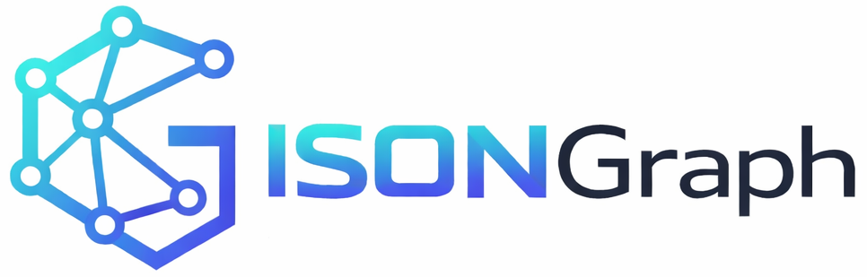

# isongraph-vector-rs



[](https://crates.io/crates/isongraph-vector-rs) [](https://docs.rs/isongraph-vector-rs) [](https://github.com/ISON-format/isongraph-vector/blob/main/isongraph-vector-rs/LICENSE)

[ISONGraph](https://github.com/ISON-format/isongraph) can walk a graph. It can
tell you who Alice knows, and who they know in turn. What it cannot tell you is
which node in the graph is *about* the thing you just asked for.

`isongraph-vector-rs` closes that gap. It embeds nodes as vectors, finds the
ones closest in meaning to a query, and then traverses the graph from there —
so a question like *"who works on machine learning?"* starts at the nodes that
actually mean that, rather than at a node you had to know the id of.

This is the Rust port. See the
[repository README](https://github.com/ISON-format/isongraph-vector#readme)
for the cross-port picture.

## Installation

```toml
[dependencies]
isongraph-vector-rs = "1.0"

# or, with the SQLite-backed store and sqlite-vec:
isongraph-vector-rs = { version = "1.0", features = ["sqlite"] }

# or, with an encoder that calls an HTTP embeddings endpoint (OpenAI / Ollama):
isongraph-vector-rs = { version = "1.0", features = ["http-encoder"] }
```

Built on [`ison-graph`](https://crates.io/crates/ison-graph) 1.4. The `sqlite`
feature pulls in `rusqlite` with its bundled SQLite, so it needs nothing
installed on the system. The `http-encoder` feature adds a small blocking HTTP
client (`ureq` with rustls); with it off, the default, the crate has no HTTP
dependency at all.

## The idea, in one example

```rust
use isongraph_vector_rs::{MockEncoder, MultiHopOptions, PropertyValue, SemanticGraph};

let mut graph = SemanticGraph::new("social", Box::new(MockEncoder::new(384)));

for (id, name, role) in [
    ("1", "Alice", "software engineer"),
    ("2", "Bob", "data scientist"),
    ("3", "Carol", "product manager"),
] {
    graph.add_node(
        "person",
        id,
        vec![
            ("name", PropertyValue::String(name.into())),
            ("description", PropertyValue::String(role.into())),
        ],
        None,
    )?;
}
graph.add_edge("KNOWS", ("person", "1"), ("person", "2"), vec![])?;
graph.add_edge("KNOWS", ("person", "2"), ("person", "3"), vec![])?;

let results = graph.semantic_multi_hop_with(
    "Alice software engineer",
    &MultiHopOptions {
        rel_type: Some("KNOWS"),
        max_hops: 2,
        threshold: -1.0,
        ..Default::default()
    },
)?;

for r in results {
    println!("{}:{}  score={:.4}  hops={}", r.node_id.node_type, r.node_id.id, r.score, r.hop_count);
}
```

```text
person:1  score=1.0000  hops=0
person:2  score=0.8000  hops=1
person:3  score=0.6400  hops=2
```

Alice matches the query directly, so she seeds the search at hop 0. Bob and
Carol are reached by traversal, and their relevance decays by `decay ** hops` —
0.8 and 0.64 with the default decay of 0.8. That decay is the whole point: a
node three hops from anything relevant should not outrank a direct match.

Three details in that snippet are worth knowing.

`threshold: -1.0` is there because `MockEncoder` is deterministic and
dependency-free but its vectors carry no meaning — they are hash-derived noise
for testing plumbing. Being near-orthogonal, and cosine similarity being
signed, mock scores straddle zero, so the default threshold of 0.3 would reject
every seed. Implement `EmbeddingEncoder` over a real model and the default is
sensible again.

Property values are typed. Since ISONGraph 1.4.0 a property can be a string, a
number, a bool or null, which is what `PropertyValue` is (a re-export of
`ison_rs::Value`, so you do not need a direct dependency on `ison-graph` to
build a property list). If all your values are strings,
`add_node_with_embed` takes plain `&str` and lifts them for you. `NodeId` is
re-exported for the same reason - it appears in every store signature, so
naming one should not cost you a second dependency.

`ISONGraph` is wrapped by composition. Read access to the underlying graph is
`graph()`. There is deliberately no mutable access: `graph().update_node(..)`
and `remove_node(..)` would change a node's text, or delete it, behind the
embedding store's back and leave stale vectors. Edges are added and removed
through `SemanticGraph::add_edge` and `remove_edge` (they carry no text, so
embeddings are unaffected); nodes through `add_node`, `update_node` and
`remove_node`, which keep each vector in step.

**Updating a node keeps its embedding honest.** With `auto_embed` on,
`update_node` re-embeds the node from its merged properties when any embed
field changed, and drops the vector if no text is left. Updates that touch no
embed field, and graphs with `auto_embed` off, leave the embedding alone:

```rust
graph.update_node("person", "1", vec![("name", PropertyValue::String("Alice, now a manager".into()))])?;
```

## Beyond a single search

**Blending in a node's own relevance.** By default a node's score comes purely
from its seed and its distance. Sometimes a node two hops out is itself highly
relevant and deserves to outrank a closer but unrelated neighbour. `blend`
mixes the two:

```rust
let results = graph.semantic_multi_hop_with(
    query,
    &MultiHopOptions { blend: 0.5, ..Default::default() },
)?;
// score = 0.5 * (seed_score * decay^hops) + 0.5 * own_similarity
```

At `blend: 0.0` (the default) scoring is pure seed-and-decay. Seeds score the
same either way, so raising it only ever reorders the nodes you reached.

**Pulling out the slice that matters.** `semantic_subgraph` runs the same
search and hands back a real `SemanticGraph` — the matching nodes, every edge
induced between them, and their embeddings. This is what makes an ISON graph
useful as LLM context: rather than serializing a whole knowledge graph into a
prompt, you serialize the part the question is actually about.

**More like this.** `similar_to_node` searches with a node's own stored vector
— no query text, no encoder call — and drops the node itself from the results.

Alongside those: `semantic_path` to reach a specific target from a
semantically-relevant start (every seed that reaches the target is scored as
`max(seed, 0) * decay^hops` and the best path wins, ties going to the more
similar seed), and `embed_all_nodes` to backfill an existing
graph in one batched encoder call. `semantic_multi_hop` keeps the original
positional form for callers who prefer it over the options struct.

## Filtering, weighting and connecting

These are new methods and option structs; the original signatures are untouched.
Queries are text or a vector (`impl Into<Query>`: `"text"` or `&vector`).

```rust
use isongraph_vector_rs::*;

let active = |n: &Node| matches!(n.properties.get("active"), Some(PropertyValue::Bool(true)));
let found = graph.semantic_multi_hop_search(
    "who runs the platform team?",
    &SearchOptions {
        weight_field: Some("strength"),                     // edge property in [0, 1]
        filter: NodeFilter::new().types(["person"]).predicate(&active).strict(),
        ..Default::default()
    },
)?;
```

- **Node filters** (`NodeFilter`: `types`, `predicate`, `strict`; AND semantics)
  work on `similarity_search_with`, `semantic_multi_hop_search`,
  `semantic_path_with` and `semantic_subgraph_with`. Seeds must pass and only
  passing nodes are returned; the filter runs *before* `top_k`, so a
  filtered-out best match costs no slot. By default a failing node may still be
  walked *through* (it costs a hop and its decay and may appear in a `path`);
  `strict()` never enters one. `semantic_path_with` returns `None` for a
  failing target. A reference with no node in the graph fails any predicate.
- **Edge weights**: `weight_field` multiplies each hop's decay by the edge's
  value, clamped to `[0, 1]` (missing, non-numeric, bool or NaN counts as 1.0;
  0 scores 0 but stays reachable). A node is scored by its best route, which
  can be longer than the shortest. `None` gives bit-identical unweighted scores.
- **Connected subgraphs**: `SubgraphOptions { connect: true, connect_max_hops: 2 }`
  adds connector nodes so the selection falls into as few components as the hop
  budget allows (greedy, shortest route first; the result may exceed
  `top_k_results`, and without `strict` a connector may fail the filter).
  `connect_max_hops < 1` is an `InvalidOption` error.

## Models and stale vectors

Every vector records the model that made it (`EmbeddingEncoder::model_name`,
`version`; `MockEncoder::with_model_name` / `with_version`). `store.models()`
counts vectors per model, and `graph.stale_embeddings(include_unknown)` lists
nodes whose vector came from a different model or width than the current
encoder; `graph.reembed_stale(include_unknown, batch_size)` rebuilds them from
their original text (resetting the store if the dimension changed). Vectors
recorded as `"unknown"` / `"provided"` are never stale by model unless you pass
`include_unknown`.

A *text* query encoded by a different model than the stored vectors compares
unrelated spaces, so it is checked: `ModelMismatch::Warn` (default; once per
model pair per store, readable from `store.warnings()`), `Error`
(`EmbeddingError::ModelMismatch`) or `Ignore`. Vector queries are never checked.
`clear_with(reset_dimension)` empties a store without (or with) forgetting its
pinned width; the original `clear()` still resets it.

## Storing the vectors

The default store is in memory. With the `sqlite` feature, embeddings persist:

```rust
use isongraph_vector_rs::{MockEncoder, NodeId, SqliteEmbeddingStore};

let mut store = SqliteEmbeddingStore::open(
    "embeddings.db",
    Some(Box::new(MockEncoder::new(384))),
    false,          // sqlite_vec
)?;
store.add(NodeId::new("person", "1"), "Alice is a software engineer", None)?;
store.add_batch(&[                       // one encoder call, one transaction
    (NodeId::new("person", "2"), "Bob analyses ML models"),
    (NodeId::new("person", "3"), "Carol plans roadmaps"),
])?;
```

The SQLite store has the same model lifecycle as the in-memory one: each write
is stamped with the encoder's `model_name()` (`"provided"` when you hand in a
vector and there is no encoder), and `models()`, `stale(model, dimension,
include_unknown)`, `on_model_mismatch` / `warnings()` for text queries,
`set_version`, `clear_with(reset_dimension)`, `export_embeddings_with(digest)`,
`save_embeddings_with(path, digest)` (atomic) and `last_import_meta()` behave as
described under *Models and stale vectors*. Differences: `models()` and
`stale()` return a `Result`, because they read the database. A database made by
an older release of any port, with no `model` column, opens fine: the column is
added and the vectors already there count as `"unknown"`.

Pass `true` for that last argument and top-k searches are answered by a
sqlite-vec `vec0` virtual table instead of a scan. It does not change what you
get back: `vec0` runs an exact brute-force KNN in C, not an approximate index
— measured identical ordering and scores within 2e-07 of the scan. Measured
over 20,000 vectors of 384 dimensions, top-10, median of five runs:
**19.0 ms** for the SQLite scan, **6.9 ms** through the index, and **9.9 ms**
for the in-memory store as it was then (its scan has since been rewritten; see
*Searching large stores*). Recall of the index against the exact scan is
**1.000** — the same answers, faster. Below a few thousand vectors the scan
wins outright, which is why the index is opt-in.

Top-k results come out of `select_nth_unstable_by` rather than sorting all of
them, which is where a third of the query time used to go. Filtering by node
type stays exact too: the type is a `vec0` metadata column, so it narrows the
search rather than filtering its results.

## Searching large stores

Search is exact unless you switch the approximate index on, and the exact path
is fast. The vectors live **once**, in one contiguous chunked `f32` matrix that
is the store itself (a record is a row of it; there is no second copy, about
1.1x the raw vector bytes at a million 384-d vectors). A search is a single pass
over it: a SIMD dot product per row (AVX2 + FMA when the CPU has them, checked
at run time), a bounded heap for the top k, and, for a big store, up to eight
threads of a persistent pool (`set_scan_threads(1)` keeps it on one). Equal
scores come back in the order the vectors were stored, so a search gives the
same answer on every run and for any thread count. See `DESIGN.md` for the
layout, the concurrency model and the write path.

### Many queries, many threads

```rust
// one call, many queries: ~10x the throughput of a loop on a big store, and
// every answer is identical (ids, scores, order) to the one-query call
let answers = store.similarity_search_vector_batch(&queries, 10, None, 0.0)?;
let by_text = store.similarity_search_batch(&["first", "second"], 10, None, 0.0)?;

// searches take &self, never lock the data, and scale across threads
std::thread::scope(|s| {
    for q in &queries { let store = &store; s.spawn(move || store.similarity_search_vector(q, 10, None, 0.0)); }
});

// readers and a writer on different threads: a reader/writer lock with short write sections
let shared = SharedEmbeddingStore::new(store);
let writer = shared.clone();
std::thread::spawn(move || writer.add(NodeId::new("doc", "9"), "new text", None));
let hits = shared.similarity_search_vector(&q, 10, None, 0.0)?;   // never sees a half-applied write
```

Batch calls run on a persistent thread pool shared by all stores (one worker per
logical CPU; `ISONGRAPH_VECTOR_THREADS=n` or `store.set_search_pool(Some(Arc::new(SearchPool::new(n))))`
changes it, `set_scan_threads(n)` caps one call). The exact batch scores 16
queries against each block of rows while it is in cache; with the index on, the
batch scores each probed cell once for all the queries that probe it.

For stores past a few hundred thousand vectors there is an opt-in approximate
index, IVF-flat, matching the Python port:

```rust
use isongraph_vector_rs::{AnnConfig, EmbeddingStore};

graph.set_ann(Some(AnnConfig::default()))?;      // or store.set_ann(..) / EmbeddingStore::with_ann(..)
let hits = graph.similarity_search("query", 10, None, 0.0)?;      // from the index
let exact = graph.similarity_search_with(
    "query",
    &SimilarityOptions { exact: true, ..Default::default() },     // the full scan
)?;
let report = graph.recall_check(&my_queries, 10, None, 0.0)?;      // measure it on YOUR queries
println!("recall@10 = {:.3}, nprobe {} of {} cells", report.recall, report.nprobe, report.nlist);
```

Vectors are clustered into `nlist` cells (default about `4 * sqrt(N)`) by a
seeded spherical k-means, and a query scores only the `nprobe` nearest cells
(default 5% of them), with the same cosine as the exact scan. It is built by the
first search that wants it, is never saved (a saved graph, its sidecar and its
digest are identical with it on or off), and is used only for a bounded `top_k`
on a store of at least `AnnConfig::min_size` (default 50,000) vectors. Writes
are visible at once: new and updated vectors are scored exactly until 256 of
them have piled up, and the write that makes it 256 folds them into their cells
(a pause of a millisecond or two at a million vectors), so a search never pays
for a backlog; deletes stop being returned, and heavy churn retrains on the next
search (call `build_ann_index(true)` yourself, off the hot path, to choose when). A `node_type`, `threshold` or `NodeFilter` applies to the probed rows;
if fewer than `top_k` survive, the probe widens 4x and tries again, ending in
the full scan. `build_ann_index`, `ann_stats` and `recall_check` are on both
`EmbeddingStore` and `SemanticGraph`. The SQLite store has no approximate index
(load its `export_embeddings` into an in-memory store to use one).

Measured with `examples/ann_bench.rs` on a 32-thread i9-14900HX laptop with
other work running, 384-d unit vectors, top 10, median of 200 queries
(synthetic clustered data; the index's recall depends entirely on how your data
clusters, so measure your own):

| vectors | exact, 1 thread | exact, auto threads | index build | IVF at default nprobe | recall@10 |
|---|---|---|---|---|---|
| 10,000 | 0.44 ms | 0.30 ms | 0.07 s | 0.043 ms | 1.000 |
| 100,000 | 6.8 ms | 3.8 ms | 0.6 s | 0.64 ms | 1.000 |
| 1,000,000 | 68 ms | 28 ms | 8.3 s | 2.4 ms | 0.993 |

On the harder, overlapping "diffuse" data the same default gives 0.986 recall
at 100,000 vectors (0.62 ms) and 0.991 at 1,000,000 (2.6 ms); lower `nprobe`
values are faster and much less accurate there (`nprobe = 16` of 4,000 cells is
0.30 recall), and below 100,000 vectors the exact scan is usually the better
choice. Run `cargo run --release --example ann_bench -- --help` to reproduce.

**HNSW (opt-in alternative to IVF).** `AnnConfig::hnsw()` (or `mode: AnnMode::Hnsw`)
builds a hierarchical navigable small-world graph instead: `m` 16, `ef_construction`
200, `ef_search` chosen by store size (about 0.95 recall@10 on 384-d text
embeddings; override with `set_ann_ef_search` or per call with
`similarity_search_vector_ef`). It stores slot numbers and links only (about 146
bytes per vector, the whole store 1.18x the raw vectors at 1M x 384), returns the
exact scan's scores for the hits it finds, links each row as it is written
(0.5-1.5 ms), tombstones deletes and bridges over them at compaction, and is
never saved. `AnnConfig::default()` stays IVF, and exact search stays the
default. The trade: on real text-384 vectors at recall about 0.95 a single query
is about 4x (100k) to 10x (1M) faster than IVF, but the build is far slower
(142-170 s at 1M against IVF's 8 s; same graph for any thread count) and IVF's
big batches stay faster at 100k. `examples/hnsw_bench.rs` sweeps `ef_search`
(recall against queries per second, build time, memory); `DESIGN.md` section 10
is the specification.

## Embedding over HTTP

With the `http-encoder` feature, `HttpEncoder` is an `EmbeddingEncoder` that
asks an embeddings endpoint:

```rust
use isongraph_vector_rs::{HttpEncoder, SemanticGraph};
use std::time::Duration;

let encoder = HttpEncoder::new("http://localhost:11434/api/embed", "nomic-embed-text", 768)
    .with_api_key(std::env::var("EMBED_API_KEY")?)   // optional
    .with_batch_size(32)
    .with_timeout(Duration::from_secs(30))
    .with_version("v1.5");
let graph = SemanticGraph::new("kb", Box::new(encoder));
```

**Every text you embed or search with is sent to that URL.** Use an endpoint you
are willing to give that text to, and prefer `https://` for anything off your
own machine. The request is `POST` with `{"model": ..., "input": [texts]}`; the
answer may be OpenAI-shaped (`data[i].embedding`, ordered by `index`) or Ollama's
`/api/embed` (`embeddings`). `model_name()` is the model you pass, so vectors are
stamped with it and a different model is caught by the checks above. HTTP 429
and 5xx are retried (twice by default, honouring `Retry-After`); redirects are
not followed, so the key cannot be forwarded elsewhere; the key is never put
in an error message or `Debug` output.

The dimension is given up front (or learned once with `.probe_dimension()?`).
Because `EmbeddingEncoder` methods cannot return errors, a failed request makes
`encode` / `encode_batch` return *empty* vectors, which every store refuses
(`EmbeddingError::EmptyVector`) — nothing bad is ever stored. The cause is in
`encoder.last_error()` and on stderr; `try_encode` / `try_encode_batch` return it
directly. The client is blocking: call it from a blocking context, not straight
from an async task.

## Saving and loading a graph

The ISON graph format carries nodes and edges only, so `save` writes the
embeddings to a sidecar next to it, `<path>.embeddings.json`, in the portable
`ison-embeddings` payload. `load` restores it when present:

```rust
use isongraph_vector_rs::{MockEncoder, SemanticGraph};

graph.save("kb.ison", None, true)?;   // kb.ison + kb.ison.embeddings.json
let graph = SemanticGraph::load("kb.ison", Box::new(MockEncoder::new(384)))?;
```

Pass the encoder you saved with, so text searches share a vector space with the
restored vectors. `save(.., false)` writes the graph alone, and `load_with` takes
`LoadOptions` (`format`, `embeddings`, `auto_embed`, `embed_fields`,
`on_mismatch`, `version`, `on_model_mismatch`). Loading never re-embeds on its
own. The sidecar is the same file the Python port writes, so a graph saved by
either can be loaded by the other. `EmbeddingStore` has the underlying
`save_embeddings` / `load_embeddings` for the sidecar alone.

**The pair stays matched.** `save` writes the graph and then the sidecar, each
atomically (temp file, sync, rename), and records in the sidecar a
`graph_digest` of the graph *as it reads back from the text just written*,
plus `encoder_model`, `encoder_version` and `graph_digest_basis`
(`"nodes-edges-json-v1"`), all after the `embeddings` array so version-1 readers
ignore them. `load` recomputes the digest and, on a mismatch (a sidecar from
another save, a graph edited since, a crash between the two writes), follows
`LoadOptions::on_mismatch`: `GraphMismatch::Error` (default), `Warn` (use the
vectors anyway) or `Reembed` (discard them and re-embed every node). A sidecar
with no digest, or one recorded on a basis this build does not compute, is
loaded unchecked. `graph_digest(&graph)` computes the digest and is
byte-identical to the Python port's (checked against the shared golden
fixture). `store.last_import_meta()` exposes what the last import recorded.

## One format, six languages

The SQLite schema and the portable JSON payload are shared by every port —
Python, C#, TypeScript, JavaScript, Rust and C++ — so a database or payload
written by one can be read by another. `MockEncoder` is byte-identical across
all six, which is what makes that guarantee testable rather than aspirational;
this suite proves it by importing a payload captured from the Python port and
checking the vectors match what Rust encodes for the same text.

```rust
let json = store.to_json()?;
store.from_json(&json, false)?;
```

## Things that will bite you

- **Search is brute force** unless you switch on the opt-in IVF index (see
  *Searching large stores*), sqlite-vec included: linear in the number of
  nodes. This is built for an application's own knowledge graph, not as a
  vector-database replacement.
- **The approximate index is approximate.** A true neighbour in an unprobed cell
  is missed; recall was measured on synthetic data only. Its k-means uses this
  port's own seeded generator, so the same `seed` builds a different (equally
  valid) index than the Python port does.
- **One embedding per node**, from one text field or a concatenation. No
  multi-vector nodes, no edge embeddings.
- **`MockEncoder` has no semantic structure.** Use it to test plumbing, never
  to judge relevance quality. For real vectors use `HttpEncoder` (feature
  `http-encoder`, which sends your texts to the endpoint you configure) or
  implement `EmbeddingEncoder` over the model of your choice.
- **`NodeId` is string-typed here.** The shared payload format carries an
  `id_type` of `str` or `int`; this port reads and preserves `int` written by
  another, but every id it originates is a string.
- **Equal scores are ordered by arrival.** Searches do not depend on `HashMap`
  order: rows are kept in the order they were stored (an update keeps its row,
  a delete and re-add goes to the end), and ties come back in that order.
- **`EmbeddingStore::get` returns an owned `EmbeddingRecord`** (the vector is a
  row of the shared matrix, so the record is built on request). Use `get_vector`
  to borrow the floats without a copy.
- **Compaction is a pause.** A store whose rows are a quarter deleted squeezes
  the matrix (order preserving), a pause proportional to its size; call
  `compact()` at a quiet moment to choose when.
- **The graph digest sees integer ids only through the file text.** `NodeId`
  is a string here, so `graph_digest(&graph)` hashes every id as a string (right
  for anything built in Rust); `save` and `load` read the id column's types from
  the ISON text instead, so integer ids written by another port still verify.
  Python writes floats in exponent form (`1e-05`) and reads them back as
  strings, so for those this port also accepts Python's reading; if a graph
  holding such floats matches neither reading, `load` warns rather than fails.
- **Auto-embed renders typed properties.** Nulls are skipped and booleans
  render as `true`/`false`, so the same graph produces the same text in every
  port.

## Tests

```bash
cargo test                      # 127 unit tests + 32 approximate-index tests + 2 doctests
cargo test --features sqlite    # + 22 SQLite tests + 3 index/SQLite tests
cargo test --features http-encoder   # + 18 HTTP encoder tests (local mock server)
cargo clippy --all-targets --features sqlite -- -D warnings
cargo fmt --check
```

## Links

- Repository: <https://github.com/ISON-format/isongraph-vector>
- Documentation: <https://graph.ison.dev/docs/isongraph-vector>

## License

MIT — see [LICENSE](https://github.com/ISON-format/isongraph-vector/blob/main/isongraph-vector-rs/LICENSE). Copyright (c) 2026 ISON - Mahesh Vaikri.
