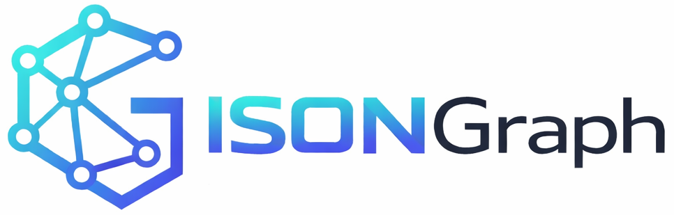

# isongraph-vector



[](https://pypi.org/project/isongraph-vector/) [](https://www.python.org/) [](https://github.com/ISON-format/isongraph-vector/blob/main/isongraph_vector-py/LICENSE)

[ISONGraph](https://github.com/ISON-format/isongraph) can walk a graph. It can
tell you who Alice knows, and who they know in turn. What it cannot tell you is
which node in the graph is *about* the thing you just asked for.

`isongraph-vector` closes that gap. It embeds nodes as vectors, finds the ones
closest in meaning to a query, and then traverses the graph from there — so a
question like *"who works on machine learning?"* starts at the nodes that
actually mean that, rather than at a node you had to know the id of.

This is the Python port, and the reference implementation: it is the only one
with a real transformer encoder, graph persistence, and a numpy-accelerated
search. See the
[repository README](https://github.com/ISON-format/isongraph-vector#readme)
for the cross-port picture.

## Installation

```bash
pip install isongraph-vector          # core
pip install "isongraph-vector[fast]"  # + numpy, ~100x faster search
pip install "isongraph-vector[vec]"   # + sqlite-vec, KNN inside SQLite
```

## The idea, in one example

```python
from isongraph_vector import SemanticGraph, MockEncoder

graph = SemanticGraph(name="social", encoder=MockEncoder(384))

graph.add_node('person', 1, name='Alice', description='software engineer')
graph.add_node('person', 2, name='Bob', description='data scientist')
graph.add_node('person', 3, name='Carol', description='product manager')
graph.add_edge('KNOWS', ('person', 1), ('person', 2))
graph.add_edge('KNOWS', ('person', 2), ('person', 3))

for r in graph.semantic_multi_hop('Alice software engineer',
                                  rel_type='KNOWS', max_hops=2, threshold=-1.0):
    print(f"{r.node_ref}  score={r.score:.4f}  hops={r.hop_count}")
```

```text
('person', 1)  score=1.0000  hops=0
('person', 2)  score=0.8000  hops=1
('person', 3)  score=0.6400  hops=2
```

Alice matches the query directly, so she seeds the search at hop 0. Bob and
Carol are reached by traversal, and their relevance decays by `decay ** hops` —
0.8 and 0.64 with the default decay of 0.8. That decay is the whole point: a
node three hops from anything relevant should not outrank a direct match.

Two details in that snippet are worth knowing up front.

`MockEncoder` is a real encoder in the sense that it is deterministic and
dependency-free, but its vectors carry no meaning — they are hash-derived
noise, meant for testing plumbing. Because they are near-orthogonal and cosine
similarity is signed, mock scores straddle zero, which is why the example
passes `threshold=-1.0`. With the real encoder you can leave the default 0.3
alone. Swap it in by simply not passing one:

```python
graph = SemanticGraph(name="social")   # builds SentenceTransformerEncoder lazily
```

The first call that needs it downloads `all-MiniLM-L6-v2`. Pass
`SentenceTransformerEncoder("some-other-model")` to use a different one.

## Beyond a single search

`semantic_multi_hop` is the headline, but it is rarely the whole job.

**Blending in a node's own relevance.** By default a node's score comes purely
from its seed and its distance. Sometimes a node two hops out is itself highly
relevant and deserves to outrank a closer but unrelated neighbour. `blend`
mixes the two:

```python
results = graph.semantic_multi_hop(query, blend=0.5)
# score = 0.5 * (seed_score * decay**hops) + 0.5 * own_similarity
```

At `blend=0` (the default) scoring is pure seed-and-decay. Seeds score the same
either way, so raising it only ever reorders the nodes you reached.

**Pulling out the slice that matters.** `semantic_subgraph` runs the same
search and hands back a real `SemanticGraph` — the matching nodes, every edge
induced between them, and their embeddings:

```python
sub = graph.semantic_subgraph("who works on machine learning?", max_hops=2)
sub.save("context.isong")
```

This is what makes an ISON graph useful as LLM context. Rather than serializing
a whole knowledge graph into a prompt, you serialize the part the question is
actually about.

**More like this.** `similar_to_node(('person', 1))` searches with a node's own
stored vector — no query text, no encoder call — and drops the node itself from
the results.

**Weighted edges.** `semantic_multi_hop(..., weight_field="strength")` multiplies
each hop's decay by that numeric edge property, clamped to [0, 1]. A missing or
non-numeric value counts as 1.0, so a half-annotated graph still works. A node
is scored by its *best* route, which with weights may be a longer one than the
fewest-hops route. The default (`None`) ignores edge properties.

**Filtering by node.** `similarity_search`, `semantic_multi_hop`,
`semantic_path` and `semantic_subgraph` take `node_filter=` (a predicate on the
`Node`) and `node_types=` (a type name or a sequence), combined with AND:

- seeds are picked *among* passing nodes (a better, filtered-out match never
  takes a seed slot), and `similarity_search` filters before it takes `top_k`;
- only passing nodes are returned, and a `semantic_path` target must pass;
- by default a failing node can still be walked *through* (it costs a hop and
  its decay and may appear in a result's `path`); `strict_filter=True` makes the
  filter a wall, so no failing node is ever entered.

**Connected subgraphs.** Top-k selection can leave the slice in pieces.
`semantic_subgraph(..., connect=True, connect_max_hops=2)` adds the interior
nodes of the shortest routes (honouring `rel_type` and `direction`) that join
the pieces — greedily, until one component remains or nothing fits the hop
budget. Those connector nodes are *extra*: the result can hold more than
`top_k_results` nodes. They are not marked, and without `strict_filter` a
connector may be a node the filter would otherwise reject.

## Storing the vectors

The store is SQLite-backed, and the default is `:memory:`. Give it a path and
the embeddings persist:

```python
from isongraph_vector import EmbeddingStore, SentenceTransformerEncoder

store = EmbeddingStore(db_path="embeddings.db", encoder=SentenceTransformerEncoder())
store.add(('person', 1), 'Alice is a software engineer')
store.add_batch([                      # one encoder call for the whole batch
    (('person', 2), 'Bob analyses ML models'),
    (('person', 3), 'Carol plans roadmaps'),
])
```

Search runs three ways, in increasing order of speed and dependencies:

| Backend | Requires | How it searches |
| --- | --- | --- |
| Pure Python | nothing | cosine loop over every vector |
| numpy | `[fast]` | one matrix-vector product against a cached matrix |
| sqlite-vec | `[vec]` | `vec0` virtual table, KNN in C |

numpy alone takes a query over 5,000 nodes from 182 ms to 2.6 ms, and is used
automatically whenever it is importable. sqlite-vec goes further, but only at
scale — and it is worth being precise about when:

| Vectors | numpy scan | sqlite-vec | |
| ---: | ---: | ---: | --- |
| 1,000 | 0.41 ms | 0.67 ms | slower — don't bother |
| 5,000 | 2.55 ms | 1.98 ms | 1.3x |
| 20,000 | 10.9 ms | 7.6 ms | 1.4x |

Recall of the index against the exact scan is **1.000** — the same answers, not
an approximation with a good hit rate. It also makes writes about 2.7x more
expensive, which is why it is opt-in:

```python
store = EmbeddingStore(db_path="embeddings.db", encoder=encoder, sqlite_vec=True)
```

Turning it on does not change what you get back. `vec0` runs an exact
brute-force KNN in C, not an approximate index — measured identical top-10
ordering over 50 queries against 20,000 vectors, with scores within 2e-07 of
the scan. It is a speed change, not an accuracy trade.

It does need a Python that can load SQLite extensions, which is not a given.
CPython only exposes `enable_load_extension` when it was configured with
`--enable-loadable-sqlite-extensions`, and several common builds are not —
the macOS builds from python.org and `actions/setup-python` among them. On
those, `sqlite_vec=True` raises `EmbeddingError` rather than silently
scanning, and the suite skips its sqlite-vec tests. Check with:

```python
import sqlite3
hasattr(sqlite3.connect(":memory:"), "enable_load_extension")
```

Homebrew's `python@3.12` and most Linux distribution builds do support it.

## Saving a graph

The ISON graph format carries nodes and edges, not vectors, so `save` writes
both halves:

```python
graph.save("social.isong")        # + social.isong.embeddings.json
graph = SemanticGraph.load("social.isong", encoder=my_encoder)
```

Pass the `encoder=` you saved with. Without it the first text search on a
loaded graph constructs a `SentenceTransformerEncoder` and downloads a model,
which is rarely what you want in a test.

**The two files stay a pair.** Each is written to a temp file and renamed into
place, so a crash never leaves a truncated file; and since two files cannot be
replaced as one, the sidecar records a `graph_digest` (sha256 over a canonical
rendering of the nodes and edges) that `load` checks. If the sidecar is from
another save, or the graph was edited, `load` follows `on_mismatch`:

```python
SemanticGraph.load(path, encoder=enc)                         # "error" (default)
SemanticGraph.load(path, encoder=enc, on_mismatch="warn")     # use the vectors anyway
SemanticGraph.load(path, encoder=enc, on_mismatch="reembed")  # rebuild every vector
```

A sidecar with no digest (older releases, other ports) loads exactly as before.

**Switching models.** Every vector remembers the model that made it.
`graph.stale_embeddings()` lists nodes whose vector is from a different model
(or has a different dimension) than the current encoder, and
`graph.reembed_stale()` re-encodes them from their stored text — resetting the
store's pinned dimension if the new model is a different size. A *text* search
whose encoder differs from the stored vectors' model warns (or raises
`ModelMismatchError` with `on_model_mismatch="error"`), because the scores would
compare vectors from unrelated spaces. `version="..."` (or an encoder's
`version` attribute) is recorded in the sidecar, and `load` warns if it changed.

## One format, six languages

The embedding sidecar and the SQLite schema are shared by every port — Python,
C#, TypeScript, JavaScript, Rust and C++ — so a store built by one can be read
by another. `MockEncoder` is byte-identical across all six, which is what makes
that guarantee testable rather than aspirational.

```python
payload = store.export_embeddings()   # portable dict, JSON-serializable
store.import_embeddings(payload)
```

The payload stays `version` 1. The metadata above (`graph_digest`,
`graph_digest_basis`, `encoder_model`, `encoder_version`) is optional and sits
after `embeddings`; readers that do not know a field ignore it.

## Things that will bite you

- **sqlite-vec needs a Python built for loadable extensions.** Not all are,
  notably the macOS python.org builds. The scan and the numpy path work
  everywhere.
- **Search is brute force in every backend**, sqlite-vec included. All three
  are linear in the number of nodes. This is built for an application's own
  knowledge graph, not as a vector-database replacement.
- **One embedding per node**, from one text field or a concatenation. No
  multi-vector nodes, no edge embeddings.
- **`MockEncoder` has no semantic structure.** Use it to test plumbing, never
  to judge relevance quality.
- **Auto-embed renders typed properties.** Since ISONGraph 1.4.0 a property can
  be a number, a bool or `None`. Nulls are skipped and booleans render as ISON
  spells them (`true`/`false`, not Python's `True`), so the same graph produces
  the same text in every port. Floats render in the shortest round-trip form,
  so an integral float is `"1"` and not Python's usual `"1.0"` — the other five
  ports would otherwise disagree with this one, and a different text means a
  different vector.

## Tests

```bash
pytest tests/                     # MockEncoder, no downloads
USE_REAL_ENCODER=1 pytest tests/  # against real sentence-transformers
```

Run from the repository root. `conftest.py` binds the import name
`isongraph_vector` to the `isongraph_vector-py/` directory, which is named to
line up with the other ports and so cannot be imported directly.

## Links

- Repository: <https://github.com/ISON-format/isongraph-vector>
- Documentation: <https://graph.ison.dev/docs/isongraph-vector>

## License

MIT — see [LICENSE](https://github.com/ISON-format/isongraph-vector/blob/main/isongraph_vector-py/LICENSE). Copyright (c) 2026 ISON - Mahesh Vaikri.
